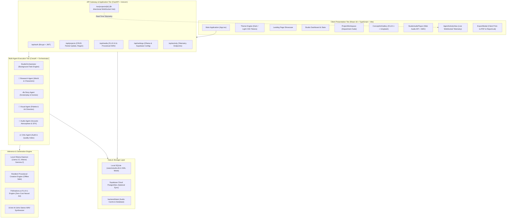

# 🛸 SwarmStudio — Comprehensive Architectural Specification & Frontend Design Blueprint

> **Document Purpose**: This document provides an exhaustive, production-grade technical and visual breakdown of **SwarmStudio**. It is specifically structured for ingestion by external AI models, designers, and software architects to immediately understand the project's vision, domain logic, tech stack, data schemas, component tree, design tokens, and current frontend state, enabling high-fidelity UI/UX and architectural recommendations.

---

## 1. Executive Summary & Problem-Solution Model

### 1.1 The Creative Silo Problem
In entertainment pre-production across **Film**, **Game Narrative Design**, and **Episodic Podcasting**, creative development is plagued by fragmentation:
- **Disjointed Prompting**: Creators jump between disjointed tools (ChatGPT for lore, Midjourney for concept art, Suno/Udio for music, and specialized screenplay formatters).
- **Context Drift**: A screenplay written in one tool loses continuity with the world-building rules or visual art direction created in another.
- **High Cognitive Overhead**: Maintaining multi-character voice profiles, scene-by-scene audio cues, lighting directives, and executive editorial continuity requires manual, labor-intensive reconciliation.

### 1.2 The SwarmStudio Solution
**SwarmStudio** provides an integrated **Multi-Agent AI Creative Collaboration Suite**. A creator inputs a single high-concept seed (premise, format, genre, and tone), and an autonomous swarm of **five specialized AI agents** collaborates sequentially and in parallel to synthesize a comprehensive production dossier:
1. **World Lore & Cultural Systems** (Research Agent)
2. **Deep Character Dossiers & Arcs** (Research Agent)
3. **Logline, Synopsis & Classical 3-Act Structure** (Story Agent)
4. **Scene-by-Scene Screenplay with Action & Dialogue** (Story Agent)
5. **Art Direction, Cinematography & 5-Color Hex Palettes** (Visual Agent)
6. **Live High-Resolution AI Concept Art** (Visual Agent + FLUX.1 neural network)
7. **Thematic Soundtracks & 16-Bit Stereo Audio Synthesis** (Audio Agent + Procedural Audio Engine)
8. **Objective Editorial Score (0–100) & Multi-Department Continuity Audit** (Critic Agent)

The platform is **Human-in-the-Loop**: creators can live-edit any generated scene, trigger targeted departmental regenerations (e.g., *"Make the ending more bittersweet"* without touching visual lore), listen to procedural music, view real-time WebSocket agent telemetry, and export professional vector PDFs or Markdown scripts.

---

## 2. High-Level System Architecture



---

## 3. Technology Stack & Key Libraries

| Tier | Technology | Version | Purpose in SwarmStudio |
| :--- | :--- | :--- | :--- |
| **Frontend Framework** | **React** | `18.3.1` | Reactive UI, hooks-driven state, concurrent rendering |
| **Language** | **TypeScript** | `5.6.3` | Strict type definitions across schemas and data contracts |
| **Styling & Design** | **Tailwind CSS** | `3.4.16` | Utility-first glassmorphism, responsive grids, custom dark tokens |
| **Build Tool** | **Vite** | `5.4.11` | Instant HMR, lightning production bundling (`tsc && vite build`) |
| **Icons** | **Lucide React** | `0.468.0` | Comprehensive creative iconography across departments |
| **Audio Processing** | **Web Audio API** | Native Browser | Dynamic harmonic tone and procedural chord progression synthesis |
| **Backend Framework** | **FastAPI** | `>=0.110.0` | Async HTTP REST endpoints, automatic OpenAPI/Swagger docs |
| **ASGI Web Server** | **Uvicorn** | `>=0.29.0` | High-throughput asynchronous HTTP and WebSocket server |
| **Agent Framework** | **CrewAI** | `>=0.80.0` | Autonomous multi-agent role definition and task pipelines |
| **Local LLM Engine** | **Ollama** | Local daemon | Privacy-first open-weight model execution (`llama3.2`, `mistral`) |
| **Authentication** | **Bcrypt + PyJWT** | `5.0.0 / 2.15.1`| Salted password hashing and secure stateless JWT token issuance |
| **PDF Compilation** | **ReportLab** | `>=4.2.0` | Programmatic executive production dossier vector PDF generation |
| **Primary Database** | **SQLite 3** | Built-in WAL | Zero-setup ACID local persistence in `backend/data/swarmstudio.db` |
| **Image Generation** | **FLUX.1 (Pollinations)**| REST CDN | Zero-cost neural text-to-concept art generation with Unsplash fallback |

---

## 4. Multi-Agent Swarm Collaboration Pipeline

The backend orchestrator executes a multi-phase sequential and parallel pipeline with context inheritance across all agents:

```mermaid
sequenceDiagram
    autonumber
    actor Creator as User / Creator
    participant O as Studio Orchestrator
    participant R as 🧠 Research Agent
    participant S as ✍️ Story Agent
    participant V as 🎨 Visual Agent
    participant A as 🎵 Audio Agent
    participant C as ⚖️ Critic Agent
    participant WS as WebSocket Hub
    participant DB as SQLite Database

    Creator->>O: POST /api/projects (Premise, Format, Genre, Tone)
    O->>DB: Save initial draft (Status: Generating, Progress: 10%)
    O->>WS: Broadcast Start Event

    rect rgb(20, 24, 40)
        Note over O,R: Phase 1: World Lore & Character Dossiers
        O->>R: Execute Research Task (Premise Context)
        R-->>O: World rules, technological systems, characters, arcs
        O->>DB: Save ResearchOutput (Progress: 30%)
        O->>WS: Broadcast Phase Complete
    end

    rect rgb(25, 30, 55)
        Note over O,S: Phase 2: Narrative & Screenplay
        O->>S: Execute Story Task (Premise + Research Context)
        S-->>O: Logline, synopsis, 3-act structure, scene breakdown
        O->>DB: Save StoryOutput (Progress: 55%)
        O->>WS: Broadcast Phase Complete
    end

    rect rgb(35, 20, 60)
        Note over O,A: Phase 3: Parallel Creative Atmosphere
        par Visual Design
            O->>V: Execute Visual Task (Research + Story Context)
            V-->>O: 5-color palette, lighting, camera notes, image prompts
        and Audio Design
            O->>A: Execute Audio Task (Story + Tone Context)
            A-->>O: Soundtracks, instrumentation, SFX cues, voice casting
        end
        O->>DB: Save VisualOutput & AudioOutput (Progress: 80%)
        O->>WS: Broadcast Phase Complete
    end

    rect rgb(40, 20, 45)
        Note over O,C: Phase 4: Continuity & Quality Audit
        O->>C: Execute Critic Task (Consolidated Multi-Department Context)
        C-->>O: Quality Score (0-100), continuity verdict, revisions
        O->>DB: Save CriticReview (Status: Completed, Progress: 100%)
        O->>WS: Broadcast Final Completion
    end

    O-->>Creator: Push Full Project Dossier via WebSocket & HTTP
```



---

## 5. Comprehensive Frontend Architecture & Design Blueprint

*(This section is specifically tailored for an external AI to inspect and propose UI/UX enhancements.)*

### 5.1 Routing and Top-Level State Management
SwarmStudio utilizes a streamlined, low-latency state-driven navigation system in [App.tsx](file:///d:/SwarmStudio/frontend/src/App.tsx) without hard URL reloads:
- **`currentView`**: `'landing'` (high-converting public marketing hero) | `'studio'` (the creative suite).
- **`currentTab`**: Navigation tabs inside the studio:
  - `'dashboard'`: Overview statistics, agent role highlights, quick-actions, project cards.
  - `'workspace'`: The core multi-department studio for the active project.
  - `'activity'`: Real-time WebSocket terminal displaying live agent thoughts and activities.
  - `'projects'`: "My Projects" library with search, format filters, and management tools.
  - `'settings'`: Model selector, Ollama server URL, Supabase sync toggles.
- **`activeProject`**: Current `ProjectData` object displayed and edited across components.
- **`currentUser`**: JWT-authenticated user profile (or `null` for guest mode). Guest mode has full capability with local storage.
- **WebSocket Synchronization**: Connects to `ws://127.0.0.1:8000/ws/projects/{project_id}`. Receives real-time incremental agent updates, progress increments, and final project payloads. HTTP polling fallback runs every 1500ms when generating.

### 5.2 Component Hierarchy & Responsibilities

```
frontend/src/
├── App.tsx                              # View coordinator, auth persistence, WS manager, tab router
├── main.tsx                             # React 18 DOM mount point with ThemeProvider wrapper
├── index.css                            # CSS variables, glassmorphism classes, sleek scrollbars
├── tailwind.config.js                   # Color palette, animations, glowing keyframes
├── contexts/
│   └── ThemeContext.tsx                 # Persistent isDark state, toggles 'light' / 'dark' HTML class
├── services/
│   ├── api.ts                           # REST client (fetch + JWT headers) & WebSocket factory
│   ├── audioSynthesizer.ts              # Dynamic in-browser Web Audio API sound generator
│   └── clientExport.ts                  # Offline Print-to-PDF engine, Markdown compiler, clipboard
├── types/
│   └── index.ts                         # Complete TypeScript data model & schemas
└── components/
    ├── layout/
    │   └── Navbar.tsx                   # Top navigation bar, active project badge, theme toggle, user auth
    ├── landing/
    │   └── LandingPage.tsx              # Public presentation page with animated feature cards & CTA
    ├── dashboard/
    │   ├── Dashboard.tsx                # Studio home, aggregate metrics, agent capability grid
    │   └── CreateProjectModal.tsx       # Creative seed intake modal (premise, genre, tone, format)
    ├── activity/
    │   └── AgentActivityView.tsx        # Live WebSocket terminal, agent state cards, thought inspector
    ├── projects/
    │   └── MyProjects.tsx               # Filterable grid of user projects with format badges & actions
    ├── settings/
    │   └── SettingsView.tsx             # Ollama connection test, model switching, storage configuration
    ├── auth/
    │   └── AuthModal.tsx                # Modal dialog for Login and Registration with bcrypt/JWT
    └── workspace/
        ├── ProjectWorkspace.tsx         # The 964-line Flagship Production Studio (Multi-Department)
        ├── ConceptArtGallery.tsx        # Neural FLUX.1 concept art grid with modal lightbox & fallbacks
        ├── StudioAudioPlayer.tsx        # Dynamic canvas waveform visualizer, audio player, stems
        └── ExportModal.tsx              # Vector PDF download, instant print-to-PDF, Markdown exporter
```

### 5.3 The Flagship Component: `ProjectWorkspace.tsx`
The primary interface for working with generated projects contains six internal sub-views:
1. **Department Navigation Tabs**:
   - `overview`: High-level synopsis, logline, executive score gauge, and quick metrics.
   - `research`: World lore, societal rules, technology, and interactive character dossier cards (archetype, appearance, motivation, arc).
   - `story`: Screenplay treatment, three-act breakdown, and an **inline editable scene-by-scene script table** (users can edit action lines and dialogue and save back to the database immediately).
   - `visuals`: Art direction guidelines, cinematography framing notes, interactive 5-color palette with 1-click Hex copying, and the embedded `ConceptArtGallery`.
   - `audio`: Soundtrack direction, tempo/instruments, sound effects cues (ambient, foley, action, stinger), and the embedded `StudioAudioPlayer`.
   - `critic`: Executive continuity audit, objective score gauge (0–100), key strengths, and prioritized improvement recommendations.
2. **Top Workspace Action Toolbar**:
   - Editable project title with direct inline saving.
   - Live generation status badge and progress bar.
   - **Quick PDF Export** button (single-click export).
   - **Comprehensive Export** button (opens `ExportModal`).
   - **Targeted Department Regeneration** button (allows prompt-guided rewriting of specific sections).

### 5.4 Complete Design System & Styling Tokens

#### Dark Mode (Primary Cyberpunk Aesthetic):
```css
--bg-primary: #090D16;          /* Deepest canvas black-indigo */
--bg-secondary: #0F1626;        /* Secondary panel background */
--bg-card: #131B2E;             /* Elevated card container */
--bg-surface: #1A233A;          /* Form inputs & active states */
--bg-hover: #24304E;            /* Hover highlights */
--text-primary: #F1F5F9;        /* Crisp slate 100 text */
--text-secondary: #94A3B8;      /* Readable slate 400 */
--text-muted: #64748B;          /* Muted metadata */
--border-primary: rgba(148, 163, 184, 0.12);
--border-accent: rgba(168, 85, 247, 0.15); /* Subtle violet glow */
```

#### Light Mode (Clean Studio Aesthetic):
```css
--bg-primary: #F8FAFC;          /* Clean studio slate 50 */
--bg-secondary: #FFFFFF;        /* Pure white cards */
--bg-surface: #F1F5F9;          /* Slate 100 surfaces */
--text-primary: #0F172A;        /* Slate 900 text */
--border-primary: rgba(148, 163, 184, 0.25);
```

#### Brand & Accent Colors:
- **Brand Violet/Purple**: `#A855F7` (500), `#9333EA` (600), `#7E22CE` (700)
- **Cyan Accent**: `#06B6D4` (used for Research / World-building)
- **Fuchsia Accent**: `#D946EF` (used for Story / Screenplay)
- **Amber/Rose Accent**: `#F59E0B` / `#F43F5E` (used for Visuals & Art Direction)
- **Emerald Accent**: `#10B981` (used for Audio & Sound Design)
- **Indigo Accent**: `#6366F1` (used for Critic & Editorial Audit)

#### Reusable CSS Utility Classes:
- `.glass-panel`: `backdrop-filter: blur(16px)` with semi-transparent background and subtle glowing border.
- `.glass-panel-hover`: Smooth transitions with border color escalation and soft purple drop-shadows on hover.
- `.gradient-border`: Pseudo-element gradient ring around premium cards.

---

## 6. TypeScript Data Models & Schemas

The frontend and backend communicate via strictly typed Pydantic and TypeScript contracts:

```typescript
export type ProjectType = 'film' | 'game' | 'podcast';
export type ProjectStatus = 'draft' | 'generating' | 'completed' | 'failed';
export type AgentStatus = 'idle' | 'waiting' | 'running' | 'completed' | 'error';

export interface ProjectData {
  id: string;
  user_id?: string;
  title: string;
  idea: string;
  project_type: ProjectType;
  tone: string;
  genre: string;
  target_audience: string;
  instructions?: string;
  status: ProjectStatus;
  progress: number;
  current_agent?: string;
  research_output?: ResearchOutput;
  story_output?: StoryOutput;
  visual_output?: VisualOutput;
  audio_output?: AudioOutput;
  critic_review?: CriticReview;
  activities: AgentActivity[];
  created_at: string;
  updated_at: string;
}

export interface Character {
  name: string;
  role: string;
  archetype?: string;
  personality: string;
  appearance: string;
  background: string;
  motivation: string;
  character_arc?: string;
}

export interface Scene {
  scene_number: number;
  title: string;
  location: string;
  time: string;
  action: string;
  dialogue?: string;
  visual_cues?: string;
  audio_cues?: string;
}

export interface ImagePrompt {
  id: string;
  title: string;
  prompt: string;
  negative_prompt?: string;
  aspect_ratio: string;
  style: string;
  image_url?: string;
}

export interface SoundEffect {
  name: string;
  scene_ref: string;
  description: string;
  category: string;
}
```

---

## 7. Current Project State & Operational Health

- **Backend Environment**: Python virtual environment (`backend/venv`) initialized with all dependencies installed (`FastAPI`, `CrewAI`, `Pydantic`, `Uvicorn`, `ReportLab`, `Bcrypt`, `PyJWT`, `WebSockets`).
- **Database & Auth Suite**: Passed all unit validation tests (`backend/test_auth_projects.py`). SQLite schema is established in WAL mode.
- **Frontend Environment**: All Node dependencies installed (`frontend/node_modules`). Production build (`tsc && vite build`) executes cleanly with zero TypeScript or bundling errors.
- **Resilient Fallback Mode**: SwarmStudio includes an offline procedural generator. If a user runs the application without Ollama installed or without GPU availability, the orchestrator detects the absence and generates rich, coherent creative treatments with zero latency or network blocks.

---

## 8. Frontend Design Evaluation & Strategic Recommendations for External AI

> [!TIP]
> **Context for External AI Prompting**: Use this section as a reference checklist when prompting another AI to suggest or implement frontend changes.

### 8.1 Current Architectural Strengths
1. **Zero External CSS Framework Debt**: Built strictly with Tailwind CSS and clean CSS custom variables, making it exceptionally easy to re-theme or alter without CSS conflicts.
2. **Unified Data Contracts**: TypeScript definitions match FastAPI Pydantic schemas 1-to-1, preventing interface drift.
3. **Multi-Modal Native Support**: Direct support for real-time Web Audio API canvas visualizers and image galleries with seed-based caching.

### 8.2 Top High-Impact Frontend Design Opportunities

#### 1. Split-Pane / Multi-Column Director Layout in `ProjectWorkspace`
- **Current State**: Single-column tabbed layout where users switch tabs to see Research vs. Story vs. Visuals.
- **Opportunity**: Introduce a modern IDE-style split pane (e.g., using `react-resizable-panels`). A creator could pin the **Screenplay / Scenes** on the left column, while viewing corresponding **Concept Art** and **Audio Stems** for the active scene on the right column.

#### 2. Component Modularization of `ProjectWorkspace.tsx`
- **Current State**: `ProjectWorkspace.tsx` is currently ~964 lines and handles all 6 departments in one file.
- **Opportunity**: Decompose it into modular sub-components:
  - `components/workspace/departments/OverviewDepartment.tsx`
  - `components/workspace/departments/ResearchDepartment.tsx`
  - `components/workspace/departments/StoryDepartment.tsx`
  - `components/workspace/departments/VisualDepartment.tsx`
  - `components/workspace/departments/AudioDepartment.tsx`
  - `components/workspace/departments/CriticDepartment.tsx`

#### 3. Visual Swarm Canvas / Node Graph
- **Current State**: `AgentActivityView.tsx` shows live telemetry as a vertical list of status cards and a terminal-style thought trace.
- **Opportunity**: Build an interactive node graph (or animated radial SVG) showing the 5 agents actively passing data tokens in real time (Research $\rightarrow$ Story $\rightarrow$ Visuals + Audio $\rightarrow$ Critic) with pulse animations when an agent is active.

#### 4. Storyboard & Scene Card Visual Redesign
- **Current State**: Scenes in the Story view are displayed in a clean standard card format.
- **Opportunity**: Provide a togglable **"Storyboard View"** alongside the screenplay view. In Storyboard mode, each scene card displays its scene number, time, location, its matching generated concept art thumbnail, audio ambient indicator, and an inline dialogue script bubble.

#### 5. Command Palette (`Cmd+K` / `Ctrl+K`)
- **Current State**: Actions are triggered via buttons in the navigation bar and workspace toolbar.
- **Opportunity**: Add a global spotlight / command palette allowing users to quickly jump between projects, switch departments, trigger regeneration, copy prompts, or export PDF without touching the mouse.

#### 6. Micro-Interactions & Motion Polish
- **Current State**: Tailwind transitions (`transition-all duration-200`) and keyframe pulses.
- **Opportunity**: Introduce subtle layout transitions and stagger animations (such as entering character cards, score gauge count-up animations, and smooth drawer overlays) using lightweight CSS or Framer Motion.

---

## 9. Quick Start Guide for Developing & Previewing Changes

```bash
# Terminal 1: Backend API
cd backend
.\venv\Scripts\Activate.ps1
python run.py
# Running at: http://127.0.0.1:8000 (Swagger docs at /docs)

# Terminal 2: Frontend Dev Server
cd frontend
npm run dev
# Running at: http://localhost:5173 with Vite Fast Refresh
```
