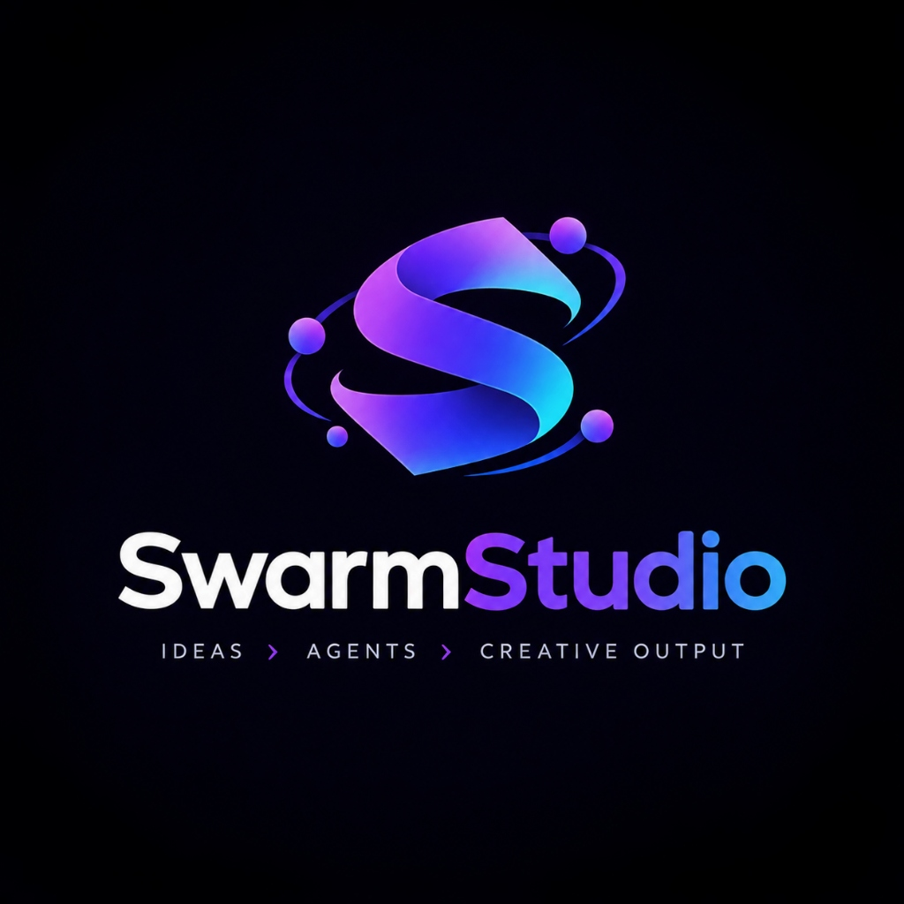
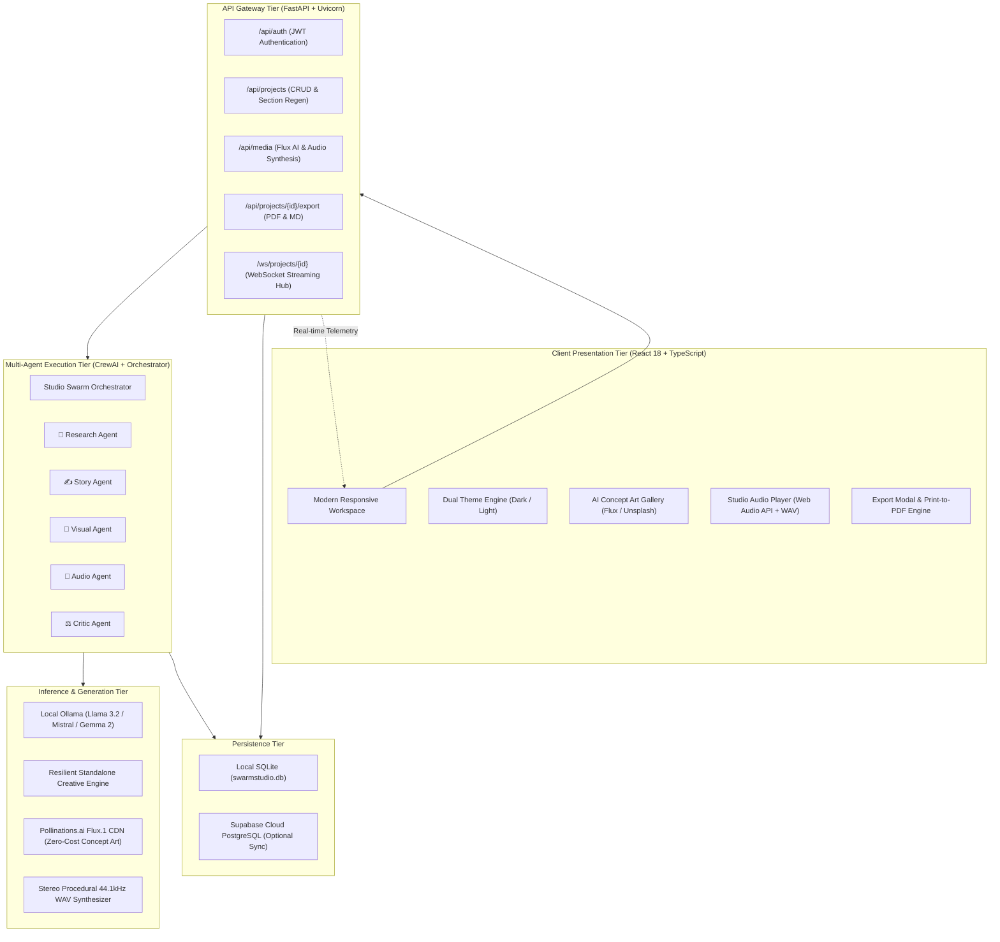
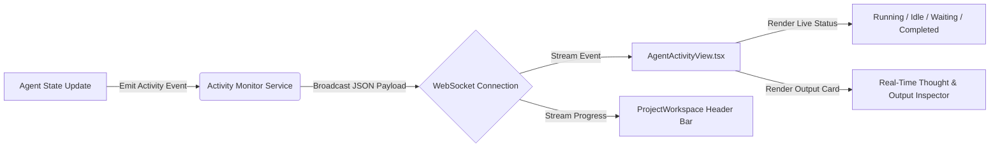

# 🛸 SwarmStudio — Multi-Agent AI Creative Collaboration Platform

<p align="center">
  
</p>

<p align="center">
  <strong>Transform high-concept premises into production-ready creative packages through a collaborative swarm of specialized autonomous AI agents.</strong>
</p>

<p align="center">
  
  
  
  
  
  
  
  
</p>

---

## 📑 Table of Contents
- [Executive Overview](#-executive-overview)
- [System Architecture](#-system-architecture)
  - [High-Level Architectural Topology](#1-high-level-architectural-topology)
  - [Multi-Agent Swarm Collaboration Pipeline](#2-multi-agent-swarm-collaboration-pipeline)
  - [Real-Time WebSocket Telemetry Flow](#3-real-time-websocket-telemetry-flow)
- [The 5 Specialized Agents](#-the-5-specialized-agents)
- [Core Features](#-core-features)
  - [1. Real AI Concept Art Generation](#1-real-ai-concept-art-generation)
  - [2. Procedural & Neural Audio Studio](#2-procedural--neural-audio-studio)
  - [3. Interactive Human-in-the-Loop Studio](#3-interactive-human-in-the-loop-studio)
  - [4. Production Export Engine](#4-production-export-engine)
  - [5. Dark & Light Theme System](#5-dark--light-theme-system)
  - [6. User Authentication & Scoped Libraries](#6-user-authentication--scoped-libraries)
- [Technology Stack](#-technology-stack)
- [Project Directory Structure](#-project-directory-structure)
- [Quick Start Guide](#-quick-start-guide)
  - [Prerequisites](#prerequisites)
  - [One-Click Startup](#one-click-startup-windows)
  - [Manual Execution](#manual-step-by-step-execution)
- [Ollama Local LLM Configuration](#-ollama-local-llm-configuration)
- [Supabase Cloud Database (Optional)](#-supabase-cloud-database-optional)
- [API Reference](#-api-reference)
- [Contributing & License](#-contributing--license)

---

## 🌟 Executive Overview

In creative production across **Film**, **Game Development**, and **Podcasting**, early-stage development is fragmented. Writers, concept artists, sound designers, and world-builders frequently operate in disconnected silos, requiring dozens of disjointed prompts across multiple individual AI tools.

**SwarmStudio** solves this through an autonomous **Multi-Agent Orchestration Engine**. A single high-level creative seed (e.g. *"A cyberpunk detective investigating synthetic memories in Neo-Tokyo"*) is assigned to an autonomous crew of five specialized agents. The agents collaborate sequentially and in parallel, passing structured production contexts to construct an interconnected creative dossier:
- **World Lore & Scientific Rules**
- **Dramatis Personae & Character Arcs**
- **Logline, Synopsis, and Three-Act Screenplays**
- **Scene-by-Scene Script Breakdown with Action & Dialogue**
- **Art Direction, Cinematography, and 5-Color Hex Palettes**
- **Real High-Resolution AI Concept Art**
- **Thematic Soundtracks & 16-Bit Stereo Audio Synthesis**
- **Editorial Scoring (0–100) & Continuity Auditing**

---

## 🏗️ System Architecture

### 1. High-Level Architectural Topology



---

### 2. Multi-Agent Swarm Collaboration Pipeline

The agents operate through structured task dependencies with continuous context inheritance:

```mermaid
sequenceDiagram
    autonumber
    actor Creator as Human Director
    participant O as Studio Orchestrator
    participant R as 🧠 Research Agent
    participant S as ✍️ Story Agent
    participant V as 🎨 Visual Agent
    participant A as 🎵 Audio Agent
    participant C as ⚖️ Critic Agent
    participant DB as Persistence Layer

    Creator->>O: Submit Creative Premise, Format, Genre & Tone
    O->>DB: Initialize Project (Status: Generating, Progress: 10%)
    
    rect rgb(30, 27, 75)
        Note over O,R: Phase 1: Foundation & World Building
        O->>R: Execute Research Task (Premise Context)
        R-->>O: World Laws, Technology, Character Dossiers & Arcs
        O->>DB: Store Research Output (Progress: 30%)
    end

    rect rgb(49, 46, 129)
        Note over O,S: Phase 2: Narrative & Screenplay
        O->>S: Execute Story Task (Premise + Research Context)
        S-->>O: Logline, Synopsis, 3-Act Structure & Scene Breakdown
        O->>DB: Store Story Output (Progress: 55%)
    end

    rect rgb(59, 7, 100)
        Note over O,A: Phase 3: Parallel Creative Atmosphere
        par Art Direction
            O->>V: Execute Visual Task (Research + Story Context)
            V-->>O: Palette, Lighting, Camera Directives & Image Prompts
        and Audio Supervision
            O->>A: Execute Audio Task (Story + Tone Context)
            A-->>O: Musical Direction, Instrument Stems & SFX Breakdown
        end
        O->>DB: Store Visual & Audio Deliverables (Progress: 80%)
    end

    rect rgb(67, 24, 255)
        Note over O,C: Phase 4: Quality & Continuity Audit
        O->>C: Execute Critic Task (Comprehensive Project Context)
        C-->>O: Overall Score (0-100), Continuity Status & Editorial Revisions
        O->>DB: Finalize Project Dossier (Progress: 100%, Status: Completed)
    end

    O-->>Creator: Deliver Live Interactive Workspace
```



---

### 3. Real-Time WebSocket Telemetry Flow



---

## 🤖 The 5 Specialized Agents

| Agent | Creative Role | Input Dependencies | Key Deliverables |
| :--- | :--- | :--- | :--- |
| **🧠 Research Agent** | World-Building & Lore Specialist | User Premise, Format, Genre, Tone | &bull; Macro-world environmental laws & technology systems<br/>&bull; Cultural & sociological rules<br/>&bull; Multi-dimensional character profiles (Archetype, Personality, Appearance, Motivation, Character Arc) |
| **✍️ Story Agent** | Lead Screenwriter & Narrative Architect | User Premise + Research Agent Dossier | &bull; High-concept Hollywood logline & dramatic synopsis<br/>&bull; Classical Three-Act Narrative Structure<br/>&bull; Complete Scene Breakdown (Location, Time, Action line, Dialogue, Visual cues, Audio cues) |
| **🎨 Visual Agent** | Art Director & Production Designer | Research Lore + Story Scenes + Aesthetic Tone | &bull; Overarching art style & aesthetic vision<br/>&bull; 5-color palette with exact Hex codes<br/>&bull; Lighting setup & cinematography framing directives<br/>&bull; Precision text-to-image prompts (Flux / Midjourney) |
| **🎵 Audio Agent** | Music Supervisor & Sound Designer | Story Scenes + Emotional Tone + Genre | &bull; Holistic soundtrack direction & musical atmosphere<br/>&bull; Tempo & primary instrumentation stems<br/>&bull; Thematic score tracks and voice delivery notes<br/>&bull; Categorized SFX breakdown (Ambient, Foley, Action, Stinger) |
| **⚖️ Critic Agent** | Executive Editorial & Continuity Critic | Complete Consolidated Deliverables (All 4 Agents) | &bull; Objective Quality Index Score (0–100)<br/>&bull; Multi-department continuity & narrative integrity verdict<br/>&bull; Key creative strengths<br/>&bull; Prioritized editorial recommendations for revision |

---

## 🚀 Core Features

### 1. Real AI Concept Art Generation
- **Direct FLUX.1 Integration**: Connects to the Pollinations.ai FLUX neural image generation network with zero API keys or billing required.
- **Aspect Ratio Adaptability**: Supports 16:9 cinematic widescreen, 9:16 vertical poster, and 1:1 square formats.
- **Intelligent Visual Fallbacks**: Automatically falls back to high-resolution Unsplash concept photography matched to project genre if the network is constrained.
- **Prompt Copy & Inspection**: 1-click prompt copying with negative prompts and style parameters for external Midjourney generation.

### 2. Procedural & Neural Audio Studio
- **Dual Synthesis Architecture**:
  - **Dynamic In-Browser Web Audio Synthesizer**: Procedurally generates harmonic scales, chord progressions, tempo, and root keys dynamically mapped to project tone and genre.
  - **16-bit 44.1kHz Stereo `.WAV` Synthesis**: Backend procedural audio engine generates real, downloadable uncompressed `.wav` sound files.
  - **Meta MusicGen Ready**: Optional hook for self-hosted MusicGen neural soundtrack generation.
- **Interactive Audio Player**: Visual stereo soundwave visualizer, scrubbable progress bar, volume controls, and loop toggle.

### 3. Interactive Human-in-the-Loop Studio
- **Inline Script Editor**: Click and edit any generated scene's action description and dialogue lines directly with instant database persistence.
- **Section-Targeted Regeneration**: Direct revisions to specific departments (e.g. *"Make the ending more bittersweet"* or *"Shift the visual style to neon noir"*) without regenerating unrelated sections.
- **Live Agent Telemetry**: View real-time thought traces, execution steps, and progress bars over active WebSocket channels.

### 4. Production Export Engine
- **Dedicated Export Modal ([ExportModal.tsx](file:///d:/GenClash/frontend/src/components/workspace/ExportModal.tsx))**:
  - **Production PDF**: Styled executive production dossier compiled via ReportLab with cover page, character cards, screenplay formatting, and critic analysis.
  - **Instant Print-to-PDF**: Client-side vector print engine formatted with `@media print` CSS rules, working **100% offline** without server dependency.
  - **Markdown Package (.md)**: Raw script treatment compatible with Final Draft, Obsidian, Notion, and GitHub.
  - **Direct Clipboard Copy**: 1-click copy of the entire script and project notes.
- **1-Click Quick PDF**: Direct button in the workspace toolbar for immediate single-click PDF export.

### 5. Dark & Light Theme System
- Seamless theme switching via persistent `ThemeContext`.
- **Dark Mode**: Cyberpunk slate and deep indigo (`#090D16`, `#0F1626`, `#131B2E`) with violet/purple glow accents.
- **Light Mode**: Crisp studio surfaces (`#F8FAFC`, `#FFFFFF`) with rich purple and slate typography.

### 6. User Authentication & Scoped Libraries
- Secure JWT-based authentication with bcrypt password hashing.
- Guest mode allows immediate exploration without registration.
- Logged-in users have personalized, user-scoped project libraries.

---

## 🛠️ Technology Stack

| Domain | Technology | Purpose |
| :--- | :--- | :--- |
| **Frontend Framework** | **React 18** | High-performance reactive UI rendering |
| **Language** | **TypeScript 5.6** | Strict type safety across project schemas |
| **Styling & Design** | **Tailwind CSS 3.4** | Modern glassmorphism, responsive grid & animations |
| **Icons & Visuals** | **Lucide React** | Consistent, high-fidelity creative iconography |
| **Build Tool** | **Vite 5.4** | Ultra-fast HMR and optimized production bundling |
| **Backend Framework** | **FastAPI 0.115** | Async Python web framework with OpenAPI / Swagger docs |
| **Server Engine** | **Uvicorn** | High-concurrency ASGI HTTP & WebSocket server |
| **Agent Orchestration**| **CrewAI** | Role-based autonomous agent framework |
| **Local LLM Engine** | **Ollama** | Local open-weight models (`llama3.2`, `mistral`, `gemma2`) |
| **Image Generation** | **FLUX.1 (Pollinations)**| Free, high-resolution text-to-image concept art |
| **Audio Synthesis** | **Web Audio API + Wave**| In-browser procedural music + 16-bit 44.1kHz stereo WAV |
| **Document Export** | **ReportLab 4.2** | Precision vector PDF generation with custom styling |
| **Primary Database** | **SQLite 3** | Zero-configuration local database persistence |
| **Cloud Database** | **Supabase (PostgreSQL)**| Optional cloud replication and synchronization |

---

## 📂 Project Directory Structure

```
GenClash/
├── backend/
│   ├── app/
│   │   ├── agents/
│   │   │   ├── crew.py                  # CrewAI multi-agent crew definition
│   │   │   └── orchestrator.py          # Orchestration pipeline & event streaming
│   │   ├── models/
│   │   │   └── schemas.py               # Pydantic data schemas & validation
│   │   ├── routers/
│   │   │   ├── auth.py                  # User registration, login, and JWT routes
│   │   │   ├── media.py                 # Flux image & music generation endpoints
│   │   │   └── projects.py              # Project CRUD, export & regeneration routes
│   │   ├── services/
│   │   │   ├── auth_service.py          # Password hashing & JWT token issuance
│   │   │   ├── export_service.py        # ReportLab PDF & Markdown generator
│   │   │   ├── media_service.py         # Pollinations AI image client & fallbacks
│   │   │   └── music_service.py         # Procedural stereo WAV synthesizer
│   │   ├── auth_deps.py                 # FastAPI dependency injection for JWT auth
│   │   ├── config.py                    # Environment settings & directory paths
│   │   ├── database.py                  # SQLite CRUD manager & Supabase sync
│   │   └── main.py                      # FastAPI application entrypoint & CORS
│   ├── data/                            # Persistent SQLite database & audio cache
│   ├── requirements.txt                 # Backend Python dependencies
│   └── run.py                           # Backend Uvicorn launcher
├── frontend/
│   ├── public/
│   │   ├── logo.jpg                     # Official SwarmStudio brand logo
│   │   └── favicon.ico
│   ├── src/
│   │   ├── components/
│   │   │   ├── activity/                # Live WebSocket agent telemetry view
│   │   │   ├── auth/                    # Login & registration modal dialog
│   │   │   ├── dashboard/               # Project creation modal & studio home
│   │   │   ├── landing/                 # High-converting product landing page
│   │   │   ├── layout/                  # Navbar, theme toggle & user controls
│   │   │   ├── projects/                # My Projects grid & filter controls
│   │   │   ├── settings/                # Ollama & Supabase configuration view
│   │   │   └── workspace/               # Interactive Studio Suite
│   │   │       ├── ConceptArtGallery.tsx# Flux AI concept art viewer
│   │   │       ├── ExportModal.tsx      # Comprehensive PDF/MD export modal
│   │   │       ├── ProjectWorkspace.tsx # Multi-department production workspace
│   │   │       └── StudioAudioPlayer.tsx# Waveform audio player
│   │   ├── contexts/
│   │   │   └── ThemeContext.tsx         # Dark / Light theme provider
│   │   ├── services/
│   │   │   ├── api.ts                   # Centralized HTTP & WebSocket API client
│   │   │   ├── audioSynthesizer.ts      # Web Audio API dynamic music synthesis
│   │   │   └── clientExport.ts          # Client-side Markdown, copy & print engine
│   │   ├── types/
│   │   │   └── index.ts                 # TypeScript interfaces and contracts
│   │   ├── App.tsx                      # Root application component & routing
│   │   ├── index.css                    # Tailwind CSS custom design tokens
│   │   └── main.tsx                     # React DOM entrypoint
│   ├── package.json
│   ├── tailwind.config.js
│   ├── tsconfig.json
│   └── vite.config.ts
├── start.bat                            # 1-click Windows batch launcher
├── start.ps1                            # 1-click Windows PowerShell launcher
├── .gitignore
└── README.md
```

---

## ⚡ Quick Start Guide

### Prerequisites
- **Python 3.10+** (Python 3.12 recommended)
- **Node.js 18+** & **npm**
- **Ollama** *(Optional for local AI inference; SwarmStudio includes a built-in offline creative engine)*

---

### One-Click Startup (Windows)

Double-click `start.bat` or run in PowerShell:
```powershell
.\start.ps1
```
This automatically initializes the Python virtual environment, installs missing dependencies, and boots both the backend API and frontend dev server simultaneously.

---

### Manual Step-by-Step Execution

#### 1. Start the Backend API Server
```powershell
# Navigate to backend directory
cd backend

# Create virtual environment (if not already created)
python -m venv venv

# Activate virtual environment
.\venv\Scripts\Activate.ps1

# Install dependencies
pip install -r requirements.txt

# Start the server
python run.py
```
- **Backend API**: `http://127.0.0.1:8000`
- **Interactive Swagger Docs**: `http://127.0.0.1:8000/docs`

#### 2. Start the Frontend Application
```powershell
# Open a new terminal and navigate to frontend directory
cd frontend

# Install Node modules
npm install

# Start Vite dev server
npm run dev
```
- **Frontend Application**: `http://localhost:5173`

---

## 🦙 Ollama Local LLM Configuration

SwarmStudio is optimized for local open-weight language models with zero API fees and complete data privacy:

1. Download and install Ollama from [ollama.com](https://ollama.com).
2. Pull your desired model via CLI:
   ```bash
   ollama pull llama3.2
   ```
   *Alternative tested models:* `mistral`, `gemma2:9b`, `phi3:medium`.
3. Start the Ollama daemon:
   ```bash
   ollama serve
   ```
4. In SwarmStudio, open **Settings** &rarr; click **Test Ollama Connection** &rarr; select your preferred active model.

> **Resilient Fallback Guarantee:** If Ollama is offline or not installed, SwarmStudio's built-in intelligent creative generation engine automatically handles generation so your demonstrations and workflow never crash.

---

## 🗄️ Supabase Cloud Database (Optional)

To enable automatic cloud replication and cross-device sync:

1. Create a free project at [supabase.com](https://supabase.com).
2. Open the **SQL Editor** in the Supabase Dashboard and execute:
   ```sql
   CREATE TABLE IF NOT EXISTS projects (
       id TEXT PRIMARY KEY,
       user_id TEXT,
       title TEXT,
       project_type TEXT,
       status TEXT,
       progress INTEGER,
       created_at TEXT,
       updated_at TEXT,
       data JSONB
   );

   ALTER TABLE projects ENABLE ROW LEVEL SECURITY;
   CREATE POLICY "Allow public read/write" ON projects FOR ALL USING (true) WITH CHECK (true);
   ```
3. Copy your **Project URL** and **anon public key** into the **Settings** tab inside SwarmStudio.

---

## 🔌 API Reference

### Core Endpoints

| Method | Endpoint | Description |
| :--- | :--- | :--- |
| `POST` | `/api/auth/register` | Register a new user account (returns JWT token) |
| `POST` | `/api/auth/login` | Authenticate existing user and retrieve JWT token |
| `GET` | `/api/auth/me` | Fetch authenticated user profile and project count |
| `GET` | `/api/projects` | List all projects (user-scoped when authenticated) |
| `POST` | `/api/projects` | Create a new project and trigger autonomous agent swarm |
| `GET` | `/api/projects/{id}` | Retrieve comprehensive project deliverables |
| `PUT` | `/api/projects/{id}` | Update scene edits, title, or metadata inline |
| `DELETE` | `/api/projects/{id}` | Remove a project |
| `POST` | `/api/projects/{id}/regenerate-section` | Trigger human-in-the-loop revision on a specific section |
| `GET` | `/api/projects/{id}/export` | Export project as styled ReportLab `.pdf` or `.md` |
| `POST` | `/api/media/generate-image` | Generate AI concept art via FLUX.1 |
| `POST` | `/api/media/generate-music` | Synthesize stereo 16-bit 44.1kHz `.wav` soundtrack |
| `WS` | `/ws/projects/{id}` | Real-time WebSocket channel for streaming agent activity |

---

## 📜 Contributing & License

Contributions, issues, and feature requests are welcome!

Distributed under the **MIT License**. See `LICENSE` for more information.

---

<p align="center">
  Built with ❤️ for creative visionaries, indie directors, game studios, and writers.
</p>
